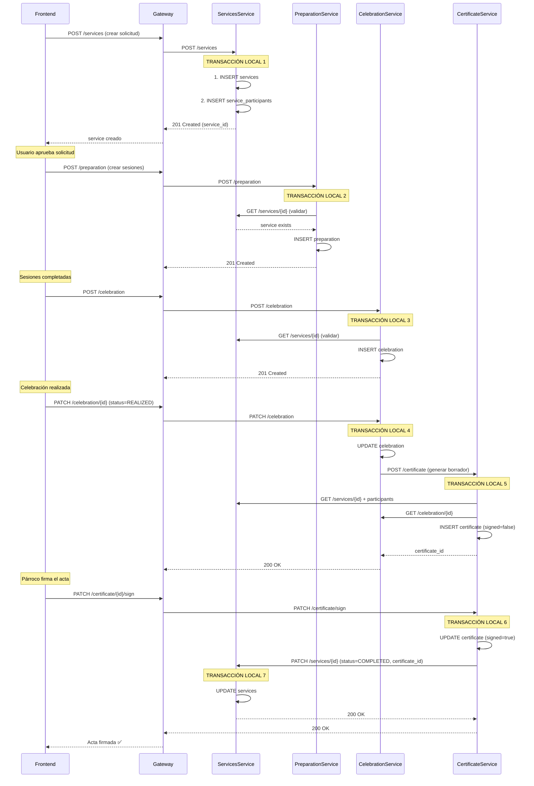

# 📊 Clasificación de Microservicios - Sistema FideInexus

## 🎯 Tipos de Microservicios

### **1. 📚 DATOS MAESTROS (Master Data)**
Contienen datos de referencia que cambian poco y son consumidos por otros servicios.

| Microservicio | Descripción | Datos que maneja | Estabilidad |
|---------------|-------------|------------------|-------------|
| **vg-ms-organizationservice** | Organizaciones/Tenants | `organizations`, `tenant_details` | ⭐⭐⭐ Alta |
| **vg-ms-locations** | Ubicaciones geográficas | `countries`, `departments`, `provinces`, `districts` | ⭐⭐⭐ Muy Alta |
| **vg-ms-sacramentservice** | Catálogos sacramentales | `service_types`, `sacraments`, `requirements` | ⭐⭐⭐ Alta |
| **vg-ms-booksservice** | Libros parroquiales | `parish_books` (catálogo de libros físicos) | ⭐⭐ Media |
| **churches** (parte de otro MS) | Iglesias/Capillas | `churches` (lugares de celebración) | ⭐⭐ Media |

**Características:**
- ✅ Baja frecuencia de cambios
- ✅ Alto volumen de lecturas
- ✅ Bajo volumen de escrituras
- ✅ Datos compartidos entre múltiples servicios
- ✅ Cachéables
- ✅ No requieren transacciones distribuidas

---

### **2. 💼 TRANSACCIONALES BÁSICOS (Simple Transactional)**
Operan sobre su propia base de datos sin coordinar transacciones con otros servicios.

| Microservicio | Descripción | Transacciones | Complejidad |
|---------------|-------------|---------------|-------------|
| **vg-ms-usersmicroservice** | Gestión de usuarios/feligreses | CRUD usuarios, autenticación | ⭐ Baja |
| **vg-ms-peopleservice** | Personas y datos personales | CRUD personas (independiente de users) | ⭐ Baja |
| **vg-ms-auth** | Autenticación y autorización | Login, JWT, refresh tokens | ⭐⭐ Media |

**Características:**
- ✅ Transacciones locales (1 base de datos)
- ✅ ACID garantizado en BD local
- ✅ No coordinan con otros servicios en tiempo real
- ✅ Patrones CRUD estándar
- ❌ No requieren saga ni 2PC

---

### **3. 🔄 TRANSACCIONALES DISTRIBUIDOS (Distributed Transactional)**
Coordinan operaciones que afectan múltiples microservicios, requieren consistencia eventual.

#### **🔴 CORE: vg-ms-servicesservice-hexagonal**
**Tipo:** Orquestador Principal de Flujo Sacramental

| Responsabilidad | Coordinación |
|-----------------|--------------|
| Crear solicitud de servicio | Local: `services` + `service_participants` |
| Enviar a preparación | → **vg-ms-preparationservice** |
| Programar celebración | → **vg-ms-celebrationservice** |
| Generar certificado | → **vg-ms-certificateservice** |
| Actualizar estado | Actualiza `status` basado en respuestas |

**Patrón:** Orquestación (Orchestration Pattern)
- Coordina el flujo completo del sacramento
- Llama a otros servicios en secuencia
- Maneja consistencia eventual

---

#### **🟠 vg-ms-preparationservice-hexagonal**
**Tipo:** Transaccional Distribuido (Dependiente)

| Operación | Base de Datos Local | Llamadas Externas |
|-----------|---------------------|-------------------|
| Crear sesión preparación | ✅ `preparation` | → **servicesservice** (validar service_id) |
| Registrar asistencia | ✅ `preparation.attendance_status` | → **servicesservice** (notificar progreso) |
| Aprobar examen | ✅ `preparation.exam_passed` | → **servicesservice** (habilitar siguiente fase) |

**Patrón:** Coreografía reactiva
- Reacciona a eventos de servicios
- Notifica cambios a servicesservice
- Consulta datos de servicios

---

#### **🟡 vg-ms-celebrationservice-hexagonal**
**Tipo:** Transaccional Distribuido (Dependiente)

| Operación | Base de Datos Local | Llamadas Externas |
|-----------|---------------------|-------------------|
| Programar celebración | ✅ `celebration` | → **servicesservice** (validar service_id)<br>→ **churches** (validar church_id) |
| Realizar celebración | ✅ `celebration.status = REALIZED` | → **servicesservice** (actualizar estado)<br>→ **certificateservice** (disparar generación) |
| Cancelar celebración | ✅ `celebration.status = CANCELLED` | → **servicesservice** (notificar cancelación) |

**Patrón:** Orquestación + Validación distribuida
- Valida disponibilidad de iglesia
- Coordina con servicesservice
- Dispara generación de certificado

---

#### **🟢 vg-ms-certificateservice-hexagonal**
**Tipo:** Transaccional Distribuido (Final del Flujo)

| Operación | Base de Datos Local | Llamadas Externas |
|-----------|---------------------|-------------------|
| Generar acta borrador | ✅ `certificate` (signed = false) | → **celebrationservice** (obtener datos)<br>→ **servicesservice** (obtener service + participants) |
| Firmar acta (párroco) | ✅ `certificate.signed = true` | → **servicesservice** (actualizar estado COMPLETED)<br>→ **servicesservice** (vincular certificate_id) |
| Anular acta | ✅ Soft delete o estado | → **servicesservice** (revertir estado) |

**Patrón:** Saga coreografiada (final step)
- Depende de celebration y services
- Cierra el flujo transaccional
- Actualiza estado en servicesservice

---

### **4. 🌐 INFRAESTRUCTURA (Infrastructure Services)**

| Microservicio | Tipo | Función |
|---------------|------|---------|
| **vg-ms-eureka-server** | Service Registry | Registro y descubrimiento de servicios |
| **vg-ms-gateway** | API Gateway | Enrutamiento, autenticación, rate limiting |

---

## 🔄 Flujo Transaccional Distribuido Completo

### **Caso: Crear Solicitud de Bautismo**



---

## 📋 Resumen por Tipo

### **Datos Maestros (5):**
1. ✅ vg-ms-organizationservice
2. ✅ vg-ms-locations
3. ✅ vg-ms-sacramentservice
4. ✅ vg-ms-booksservice
5. ✅ churches (integrado en otro MS)

### **Transaccionales Básicos (3):**
1. ✅ vg-ms-usersmicroservice
2. ✅ vg-ms-peopleservice
3. ✅ vg-ms-auth

### **Transaccionales Distribuidos (4):**
1. 🔴 **vg-ms-servicesservice** (Orquestador Principal)
2. 🟠 **vg-ms-preparationservice** (Dependiente)
3. 🟡 **vg-ms-celebrationservice** (Dependiente)
4. 🟢 **vg-ms-certificateservice** (Final del Flujo)

### **Infraestructura (2):**
1. ✅ vg-ms-eureka-server
2. ✅ vg-ms-gateway

---

## 🎯 Patrones de Consistencia Utilizados

### **1. Consistencia Eventual (Eventual Consistency)**
Los microservicios transaccionales NO usan 2PC (Two-Phase Commit), sino:
- **Orquestación:** servicesservice coordina llamadas
- **Coreografía:** Servicios reaccionan a cambios de estado
- **Compensación:** Si falla un paso, se revierte manualmente

### **2. Sin SAGA Formal Implementada**
Actualmente el sistema **NO tiene patrón SAGA implementado**, pero debería tenerlo para:
- ✅ Rollback automático si falla celebración
- ✅ Compensar si falla generación de certificado
- ✅ Deshacer preparación si se cancela servicio

---

## 🚨 Recomendaciones de Mejora

### **Para Transaccionales Distribuidos:**

1. **Implementar SAGA Pattern:**
   ```java
   @Service
   public class ServiceSagaOrchestrator {
       public Mono<ServiceResult> createServiceWithSaga(ServiceRequest req) {
           return createService(req)
               .flatMap(this::createParticipants)
               .flatMap(this::notifyPreparation)
               .onErrorResume(this::compensate); // Rollback
       }
   }
   ```

2. **Event Sourcing para Auditoría:**
   - Registrar cada cambio de estado en `service_events`
   - Reconstruir estado desde eventos

3. **Circuit Breaker:**
   ```java
   @CircuitBreaker(name = "preparationService", fallbackMethod = "fallbackPreparation")
   public Mono<Preparation> createPreparation(Long serviceId) {
       return webClient.post()...
   }
   ```

4. **Idempotencia:**
   - Agregar `idempotency_key` en operaciones críticas
   - Evitar duplicados en creación de certificates

---

## 📊 Tabla Resumen Final

| Microservicio | Tipo | BD Propia | Llamadas Externas | Patrón |
|---------------|------|-----------|-------------------|--------|
| organizationservice | Maestro | ✅ | ❌ | CRUD |
| locations | Maestro | ✅ | ❌ | CRUD |
| sacramentservice | Maestro | ✅ | ❌ | CRUD |
| booksservice | Maestro | ✅ | ❌ | CRUD |
| usersmicroservice | Transaccional Básico | ✅ | ❌ | CRUD |
| peopleservice | Transaccional Básico | ✅ | ❌ | CRUD |
| auth | Transaccional Básico | ✅ | ✅ (users) | Autenticación |
| **servicesservice** | **Transaccional Distribuido** | ✅ | ✅ (prep, celeb, cert) | **Orquestación** |
| **preparationservice** | **Transaccional Distribuido** | ✅ | ✅ (services) | **Coreografía** |
| **celebrationservice** | **Transaccional Distribuido** | ✅ | ✅ (services, churches) | **Orquestación** |
| **certificateservice** | **Transaccional Distribuido** | ✅ | ✅ (services, celeb) | **SAGA Final** |
| eureka-server | Infraestructura | ❌ | ❌ | Service Registry |
| gateway | Infraestructura | ❌ | ✅ (todos) | API Gateway |

---

**Última actualización:** 19 octubre 2024  
**Arquitectura:** Microservicios con Arquitectura Hexagonal + Spring WebFlux (R2DBC)  
**Patrón principal:** Orquestación sin SAGA formal (mejorar a futuro)
